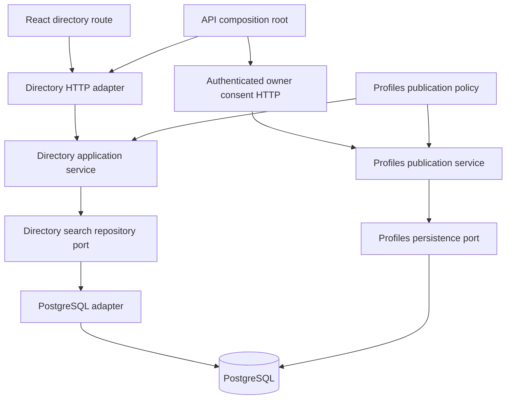

# Milestone 4 — Alumni Directory & Discovery design

Date: 2026-10-24 (Asia/Jakarta). Base: `1537c8899fa8fff51ecc7fac01db1d1f8814526c`.
Status: **Approved Phase A design; backend foundation implemented in Phase B, UI not implemented**.

See [Phase B implementation and test evidence](milestone-4-phase-b-backend.md). Membership-first locking refines the preliminary order below to coordinate with the database revocation safeguard.

Canonical policy: [ADR 0002](decisions/0002-directory-discoverability.md). Execution and repository evidence: [directory plan](milestone-4-directory-plan.md). Product requirements: [PRD](prd.md).

## 1. Goals, non-goals and user stories

Enable anonymous discovery of explicitly opted-in, verified alumni professional profiles, initially serving UHAMKA Mathematics Education while supporting other institutions and programs without hardcoded community identifiers.

User stories:

- A visitor searches a name, profession, company, skill or consented academic affiliation and opens a canonical public profile.
- A verified alumnus chooses whether to be listed and separately chooses which academic affiliation fields can be searchable and displayed.
- A student or pending applicant can share an explicitly PUBLIC profile directly without being listed or falsely labeled verified.
- A member withdraws publication/discovery consent and subsequent queries exclude the withdrawn data.
- A keyboard/mobile user can apply filters, understand results and navigate pages without losing focus or encountering an auth wall.

Non-goals: Connections, messaging, recommendations, private member search, a verification/admin interface, proof uploads, automatic alumni promotion, photo redesign, production provider replacement, external search engines, distributed infrastructure and resolution of the separate concurrency issue #11. No reputation ranking or full profile history in result cards.

## 2. Discoverability and access model

Effective eligibility is the conjunction of:

```text
profile exists
AND visibility = public
AND moderation_status = visible
AND directory_discoverable = true
AND EXISTS trusted alumni membership with status = verified
```

Discovery consent defaults false for existing and new profiles. PUBLIC alone is insufficient. Verification comes from `memberships`, never Keycloak claims, profile education, user-submitted badges or the existence of a graduation year. Multi-role accounts qualify only through an actual verified alumni membership. Institutions/programs from pending memberships remain unavailable to directory filters even when another membership qualifies the person.

Anonymous visitors, signed-in students, applicants and verified alumni see the same projection. An administrator using the public route sees the same data; any later private administrative read belongs to a separately authorized workflow. Authentication is required only for owner consent operations in this milestone. Public browsing does not trigger OIDC initialization/login as a prerequisite; preserve the existing exact callback and S256 PKCE behavior.

### Profile eligibility matrix

All entries assume other eligibility conditions hold unless stated otherwise.

| Profile / account state | Direct anonymous profile | Directory listing / filter match | Verification indicator |
| --- | --- | --- | --- |
| Student only, PUBLIC, discovery requested | Existing direct access allowed | Excluded; enabling discovery rejected | False |
| Pending or rejected alumni only, PUBLIC | Existing direct access allowed | Excluded; enabling discovery rejected | False |
| Trusted verified alumni, PUBLIC, no discovery consent | Allowed | Excluded | True on existing direct profile; no directory result |
| Trusted verified alumni, PUBLIC, discovery consent | Allowed | Eligible, subject to individual field consent | True, server-derived |
| Student/pending plus a separate verified alumni membership | Allowed when PUBLIC | Eligible only through verified membership and consent | True for verified alumni status; no claim about pending affiliations |
| PRIVATE, regardless of membership/consent | Non-disclosing 404 | Excluded | No result |
| Moderator HIDDEN, regardless of owner choices | Non-disclosing 404 | Excluded | No result |
| Deleted account | Non-disclosing 404 | Excluded | No result |
| Historical slug of an eligible owner | Existing relative 307 to canonical slug | No separate row; old slug not searched | Derived at current destination |
| Historical slug of PRIVATE/HIDDEN/deleted owner | 404 without Location | Excluded | No result |
| Permanent slug tombstone | 404, no owner pointer disclosed | Excluded and never reassigned | No result |

### Field privacy matrix

Search and return decisions must use the same publication predicate. Never search a private value and then hide it only in the response.

| Data | Directory searchable/filterable | Card response | Consent / source |
| --- | --- | --- | --- |
| Canonical slug | Ordering/navigation only, not a search field | Yes | Existing PUBLIC core + discovery consent |
| Display name | Case-insensitive literal prefix | Yes | Existing PUBLIC core + discovery consent |
| Headline | Not searched in initial contract | Yes | Existing PUBLIC core + discovery consent |
| Current company | Prefix filter | Only when published | `show_current_company=true` |
| Current job title | Prefix filter | Only when published | `show_current_job_title=true` |
| Skills | Exact normalized names; all requested skills must match | Published names only, bounded by existing 100-skill cap | `show_skills=true`; vocabulary is not verification |
| University | Exact public reference slug | Only consented affiliation | Per verified membership `show_institution=true` |
| Study program | Exact public reference slug scoped to university | Only when consented | `show_study_program=true` requires `show_institution` |
| Graduation year | Exact year; not enrollment year/cohort inference | Only when consented | `show_graduation_year=true` requires `show_institution` |
| Alumni verification | Eligibility predicate, not caller-selectable | `verified_alumni: true` | Trusted alumni membership; opt-in copy explains the badge |
| Photo | Never searched | Controlled relative photo URL only when published | Existing `show_photo` and backend public-photo checks |
| Bio, location, experience and education history | No | No | Remain separately controlled on the direct profile; `show_educations` does not publish memberships |
| NIM, email/contact data, OIDC subject, internal user/membership IDs, evidence, moderation metadata | Never | Never | Not directory data, including logs, cursors, counts, snippets or errors |

Additional academic consent is required even if the user published education history. Each verified membership has its own flags. A card may show generic verified status with no academic affiliation. Public reference institution/program slugs are permitted; internal membership/user UUIDs are not. All combined academic filters must match **one and the same** verified, appropriately consented membership, preventing cross-affiliation false matches.

### Consent transitions

- Opt-in requires current PUBLIC, VISIBLE and verified eligibility, checked inside the write transaction. Do not publish a profile implicitly when enabling discovery.
- Opt-out clears directory and academic consent atomically. PRIVATE does the same, including through the existing privacy PATCH; subsequent PUBLIC does not restore it.
- HIDDEN suppresses reads immediately at the next SQL snapshot, while retaining owner choices. An authorized unhide may restore an otherwise eligible listing; document this in consent/help copy.
- A future verifier that revokes the last verified alumni membership must clear directory and academic consent in the same transaction. Removing a single membership cascades its own academic consent; other eligible memberships can remain. Until that workflow exists, fixtures change only isolated databases.
- Account deletion cascades profile/consent records, retaining the existing anonymous slug tombstones and photo cleanup intent.
- [ADR 0001](decisions/0001-last-writer-wins-development.md) and [#11](https://github.com/sipratama/alumnibridge/issues/11) remain explicit production gates. Transactional eligibility checks prevent partial writes, but do not detect a stale owner choosing PUBLIC/opt-in after withdrawal. No separate GET preflight can provide atomic conflict detection.

## 3. Candidate REST contract

The Phase B backend implements these routes in [OpenAPI](../apps/api/openapi/openapi.yaml). Full rate limiting and performance/abuse hardening remain Phase C; 429 below is a planned future response, not an implemented Phase B capability.

### Anonymous search: `GET /api/v1/directory`

| Parameter | Proposed validation and semantics |
| --- | --- |
| `query` | Optional name prefix; trim/collapse spaces; 2–100 Unicode code points when supplied |
| `institution` | Exact public institution slug, 1–64 ASCII lowercase letters/digits with interior hyphens |
| `study_program` | Same slug syntax; requires `institution` because program slugs are institution-scoped |
| `graduation_year` | Integer 1950–2100, matching current membership CHECK; optional without institution but still requires consent |
| `company` | Optional current-company literal prefix, 2–160 code points; publication flag required |
| `job_title` | Optional current-job-title literal prefix, 2–160 code points; publication flag required |
| `skills` | Repeat key up to 5 times, e.g. `skills=Go&skills=Teaching`; 1–80 code points each, reuse existing whitespace/lowercase normalization; reject equivalent duplicates; exact match, AND across values |
| `limit` | Integer 1–50, default 20; excessive values rejected rather than silently clamped |
| `cursor` | Optional opaque token, at most 2048 ASCII bytes; strict decoding/version/expiry/filter binding |

Initial order is **canonical slug ascending with explicit PostgreSQL `C` collation**. Slugs are already unique, ASCII and public; no internal identifier tie-break is required. No ranking, caller-selected sort or offset. This trades name-order familiarity for a simple, portable deterministic first contract; user-friendly name ordering is a later measured product choice. Explain alphabetical-by-profile-link order in UI help if necessary.

Filters combine with AND; within a single name/company/title prefix there is no regex, boolean language, wildcard syntax or fuzzy matching. Escape `%`, `_` and the escape character before building parameterized LIKE patterns. Omitted text means no filter; explicitly empty text, invalid UTF-8/NUL/control characters, unknown keys, duplicate scalar keys, malformed integers and a raw query string above 4096 bytes return 400. A syntactically valid but unknown institution/program/skill yields an empty result, without probing any private membership. Empty filter set is allowed for bounded browsing. Do not infer graduation year from education dates.

Successful response (optional fields shown only to illustrate their shape):

```json
{
  "items": [
    {
      "slug": "example-alumna",
      "display_name": "Example Alumna",
      "headline": "Mathematics educator",
      "verified_alumni": true,
      "current_company": "Example School",
      "current_job_title": "Teacher",
      "skills": ["teaching"],
      "affiliations": [
        {
          "institution": {"slug": "uhamka", "name": "Universitas Muhammadiyah Prof. Dr. HAMKA"},
          "study_program": {"slug": "mathematics-education", "name": "Mathematics Education"},
          "graduation_year": 2020
        }
      ],
      "photo_url": "/api/v1/profiles/example-alumna/photo"
    }
  ],
  "next_cursor": null
}
```

Forbidden optional fields are omitted, not replaced by private values or diagnostic placeholders. `affiliations` is omitted when none is consented; each element contains only consented keys, sorted by institution/program public slugs then year. Bound owner academic consent records to 20 so projection is bounded; no public membership identifiers. Published skills use deterministic normalized-name order and the existing maximum of 100. No completeness, internal timestamps, photo object keys or full history. No `total`, facet counts, popularity or private-value autocomplete. No results: 200 with `items: []`, `next_cursor: null`.

### Owner consent: `GET/PATCH /api/v1/users/me/profile/discovery`

Reuse verified JWT resolution and owner profile initialization. GET supplies private owner consent settings, effective eligibility and the owner's verified membership choices with internal membership IDs; these IDs never enter anonymous DTOs. Known ineligibility may be explained to the owner only. PATCH accepts an object with either/both:

- `directory_discoverable`: explicit boolean; omitted means unchanged, null is invalid.
- `affiliations`: replacement array of up to 20 entries, each with the owner's verified `membership_id` and all three explicit boolean flags. Omitted means unchanged; `[]` clears all academic flags. Duplicate memberships, unknown keys and invalid flag dependencies are 400. `{}` is invalid. Cap the body at 16 KiB; enforce 413/415 using existing strict JSON handling.

The resulting state is validated atomically. Academic publication requires discovery consent. A request disabling discovery while also publishing an affiliation is invalid; ordinary opt-out clears all academic flags. Foreign/nonexistent membership IDs return the same 404 and roll back the entire update; owned non-verified memberships are not eligible and return 409. PUBLIC/verification/moderation prerequisites that changed during editing return 409. An opt-out remains allowed even when no longer eligible. Never accept owner ID, verification status or moderation input.

Responses use the existing `{"error":"code"}` style: 400 invalid input/cursor, 401 missing/invalid/expired JWT on owner routes, 404 foreign/nonexistent owner resource, 409 eligibility conflict, 413/415 invalid owner body size/media, 429 rate limited with `Retry-After`, 503 bounded search temporarily unavailable, generic 500 unexpected failure. Do not invent a 403 for anonymous browsing or owner-resource existence checks. Add a documented 403 only if a real future privileged operation needs one. No raw SQL/storage errors.

Both anonymous search and owner consent responses, including errors, use `Cache-Control: no-store` and `X-Content-Type-Options: nosniff`. No public ETag/304 or intermediary result cache is proposed. Existing public profile/photo endpoints retain their current privacy/redirect behavior.

## 4. Backend boundaries

Follow existing `internal/profiles`, `profiles/postgres`, `profiles/http` conventions, rather than creating empty `domain/app` subdirectories.



- `internal/directory`: concrete service, validated `SearchSpec`, public `Entry`, `Page`, cursor boundary value and small consumer-defined repository interface, e.g. `Search(context.Context, SearchSpec) (Page, error)`. Only add interfaces needed for tests/adapters; no generic repositories.
- `internal/directory/postgres`: pgx implementation of bounded public read projection over existing tables; SQL and database error mapping stay here. Return directory allowlist types, not user or membership models.
- `internal/directory/http`: parameter decoding, response DTO mapping, cache headers and errors. Cursor codec stays at the adapter/service boundary; SQL receives only a validated public slug anchor. Standard-library authenticated encryption can implement the codec without a new package dependency.
- Owner discovery choices belong to profiles publication service/store, not directory read handlers. Resolve actor through the existing verified OIDC-to-internal-UUID path. Scope membership consent changes by both actor and membership in SQL; lock affected memberships in UUID order, then the profile and affiliation rows, matching the membership lifecycle trigger. Privacy-only writers lock profile then affiliations without taking membership locks.
- Share named, pure publication predicates/field policy with profiles where useful. Keep direct-profile PUBLIC checks distinct from the stricter directory eligibility predicate. The directory SQL necessarily enforces the policy at persistence; keep it next to the explicit projection and use shared policy fixtures/contract tests against both adapters to prevent drift. Do not call `Public()` for every result (N+1), or copy its entire history/photo aggregation query.
- Directory is an explicit cross-module read over trusted membership/reference data in the same database. It neither writes membership status nor introduces a verification module port for a workflow that does not yet exist. Any future verification writer owns its transaction and consent invalidation integration.
- Wire concrete constructors in `cmd/api`; propagate request context through all work, close pgx rows and map cancellation safely. No HTTP/pgx/Keycloak imports in domain/service policy, no internal HTTP calls or event bus.

## 5. Existing schema and proposed changes

Reviewed migration sources (not an assertion about the local running database):

| Migration | Relevant existing guarantees |
| --- | --- |
| [000001](../infrastructure/migrations/000001_identity.up.sql) | UUID users; institution/program references; role/status/year CHECKs; unique per-user/program/role membership |
| [000002](../infrastructure/migrations/000002_profiles.up.sql) | PRIVATE default; optional public flags false; unique slug; profile histories, skills and owner links |
| [000003](../infrastructure/migrations/000003_profile_details.up.sql) | Additional experience/education fields, not membership verification |
| [000004](../infrastructure/migrations/000004_slug_reservations.up.sql) | Immutable reservations; owner-binding FK; deleted-account tombstones and guarded rollback |
| [000005](../infrastructure/migrations/000005_public_profiles_photos.up.sql) | Moderation filter, complete photo metadata, durable object registry and cleanup indexes |

Proposed new additive, reversible migration in Phase B, numbered after the then-current tip (currently 000006):

1. `profiles.directory_discoverable BOOLEAN NOT NULL DEFAULT false`; `directory_consented_at TIMESTAMPTZ` nullable. CHECK: consent true requires a timestamp; false requires null. Server UTC timestamp, never supplied by the client. Enabling consent records time; disabling clears it. This is current consent state, not a fabricated historical audit trail.
2. `profile_directory_affiliations`: `membership_id UUID PRIMARY KEY REFERENCES memberships(id) ON DELETE CASCADE`; three NOT NULL boolean publication flags DEFAULT false; `updated_at TIMESTAMPTZ NOT NULL DEFAULT now()`; CHECKs require institution consent for program/year consent. Membership FK already leads to the user; avoid a duplicated, potentially inconsistent owner column. All writes join owner memberships. Store only explicit selections; absence means all false. Maximum 20 records per owner enforced while holding the owner profile lock, including concurrent requests.
3. Existing profile field privacy flags and `profile_skills` remain authoritative. No copied membership evidence, search shadow of private fields, profile version mechanism or materialized public index in Phase A/B.
4. Candidate indexes: partial profiles B-tree on `slug COLLATE "C"` for PUBLIC/VISIBLE/opted-in rows; partial verified alumni membership index by `(user_id, study_program_id, graduation_year)`; reverse `(study_program_id, graduation_year, user_id)` only if measured academic-filter plans need it; reverse `(skill_id, user_id)` for profile skills if plans justify it. Existing institution slug and scoped program slug uniqueness support reference lookup. Avoid adding every candidate speculatively.
5. Candidate normalized-prefix expression indexes for display name/company/title must exactly match SQL normalization, collation and publication predicates. A normal B-tree does not magically accelerate arbitrary `ILIKE '%term%'`. Begin with escaped lowercased literal prefixes and matching `text_pattern_ops`/C-collation expressions as appropriate; prove actual plans before adding indexes. A users-table name index cannot enforce cross-table profile consent; eligibility stays explicit in SQL.

Migration down removes only new indexes/table/columns; it must not alter migrations 000001–000005, drop tombstones, reset verification or erase photo registry work. Downgrading loses newly added consent settings and leaves discovery disabled because the older app has no directory; document this before deployment. Apply/down/reapply only in disposable databases, plus existing tombstone/photo rollback refusal tests. Phase A created no migration file; Phase B now adds migration 000006 and narrow database lifecycle safeguards.

### Query shape and matching

One parameterized statement selects eligible profiles, applies all filters, applies the slug anchor, orders and fetches `limit + 1`. Use `EXISTS` for verified membership and skills to avoid duplicate profile rows. Academic predicates share one consented verified-membership `EXISTS`, including institution/program/year conditions. Professional matching is explicitly gated by `show_current_company`, `show_current_job_title` or `show_skills`; query does not search bio, histories or unshared membership text.

Return only consented academic fields and profile fields from that same statement snapshot, with bounded aggregate subqueries over the already limited page. Fetch neither whole raw models nor per-profile follow-up requests. Database owner UUIDs may be used in joins but never serialized or placed in cursors. Parameterize all values, whitelist fixed SQL clauses and bound any dynamically assembled filter list to five skills.

No private-field full-text index or cross-profile autocomplete. PostgreSQL [B-tree/index behavior](https://www.postgresql.org/docs/17/indexes-types.html) informs the prefix strategy. [pg_trgm](https://www.postgresql.org/docs/17/pgtrgm.html) can support LIKE/ILIKE via GiST/GIN, but adds extension privileges, write/storage cost and poor selectivity for short patterns; defer it until substring/fuzzy search has a demonstrated need. PostgreSQL full-text search adds tokenization/language/ranking decisions unsuited to an initial literal-prefix contract. Neither requires an external search service, and neither is approved for Phase B merely by being discussed here.

## 6. Pagination and concurrent changes

- Fixed slug order, no offset. Query `slug > anchor` with the exact C collation used for ordering. Unique canonical slug is its own tie-break. Static eligible data yields deterministic pages with no duplicates.
- Fetch one extra eligible row to decide `next_cursor`; anchor the cursor at the last **returned** row, never at a hidden/extra row. No total count or hidden cardinality in the token.
- Cursor is URL-safe authenticated ciphertext with version, expiry (15 minutes), hash of canonical filters/limit/order and last public canonical slug only. No UUID, email, private search value, membership ID, object key or raw SQL inside, even encrypted. The query fingerprint prevents replay with changed filters; filters themselves are not embedded. Use random nonces, standard authenticated encryption, bounded decoding and environment-supplied keys; no home-grown cipher or committed secret. Key rotation/restart may invalidate cursors safely; return generic 400 and let the client restart. Never log tokens or distinguish signature, expiry and hidden-resource cases in public errors.
- Query changes, including page size, restart at page one. Previous navigation can retain prior request cursors in transient memory and re-fetch; do not persist result pages or tokens in URLs/local storage. Shareable URLs contain filters only.
- Every page re-evaluates eligibility and field consent. A private/hidden/deleted anchor remains a usable opaque lexical boundary; it is not looked up and does not authorize that owner. Historical slugs do not enter results. An entry whose membership/field consent changed cannot match using the old private value on a new statement.
- This is live pagination, not a cross-request snapshot. New opt-ins before the anchor may be missed until restart. Slug changes can move a result across a boundary and cause a repeat/skip; UI de-duplicates displayed canonical slugs and offers refresh, but cannot promise identity-based deduplication across renames without identifiers. Do not add a new public identity/version scheme solely to conceal this limitation.
- Per PostgreSQL [Read Committed semantics](https://www.postgresql.org/docs/17/transaction-iso.html), an in-flight SELECT may complete from a snapshot preceding withdrawal. A query begun after a committed withdrawal must exclude it. No long-lived repeatable-read browsing transaction, cached cursor snapshot or lock over browser navigation. Atomic stale-write rejection in #11 addresses a different race and remains necessary before production.

## 7. Security, abuse and cache boundaries

| Risk | Planned control / limitation |
| --- | --- |
| Private-field inference via matching | Gate predicates before matching and project only published fields; paired fixtures differ solely in hidden data and must yield equal logical responses |
| Counts/facets/snippets/autocomplete | Do not add these endpoints or metadata; never provide hidden membership counts or profile-derived private vocabulary |
| SQL injection and expensive syntax | Parameterized escaped prefixes; five exact skills maximum; strict input/length/key validation; no regex, arbitrary sort or wildcard language |
| Unbounded work | Page max 50, body/query caps, bounded affiliations/skills, one page SQL statement, context propagation; propose 2-second search deadline with shorter DB statement timeout and measure in Phase C |
| Scraping/enumeration | Opt-in consent explains public copying; no UUID lookup/export; implement bounded rate/concurrency admission before shared/public deployment; cannot guarantee anti-scraping |
| Development limiter | Phase C starting proposal: 60 searches/minute with burst 10 per source IP, finite 10,000-entry map/TTL eviction and global search concurrency cap; configurable and tested, not benchmarked capacity claims |
| Spoofed identity/proxy headers | Do not trust owner IDs, roles or arbitrary `X-Forwarded-For`; trust proxy forwarding only for explicitly configured ingress; authenticated public search cannot bypass the limiter or projection |
| Multi-instance production | Per-process limits are insufficient; approve ingress/WAF global budgets and trusted proxy topology before launch, without introducing Redis in this milestone |
| Cache leakage | `no-store` on results/errors/consent; no CDN/service-worker result cache, no persisted Query data; owner changes cancel/remove directory and public-profile queries |
| Logging/analytics | Record route, bounded outcome class, duration and request ID; do not log raw filters, cursor, names, affiliations, token, email or SQL arguments; configure ingress URL redaction too |
| Privacy/moderation races | Same-statement predicates and projection on every page; transactional withdrawals; #11 still blocks multi-session production revocation guarantees |
| Timing side channels | No hidden matches/counts; avoid executing field search against unpublished candidates; bound time and assess query plans. Logical non-disclosure tests do not prove constant-time SQL or eliminate all statistical timing inference |

Returning a discoverable record is deliberate public disclosure, not a guarantee that it cannot be saved externally. A cursor is pagination state, not access control. Keep all original JWT signature/issuer/audience/expiry/ownership checks on owner routes and signed-token regressions. MinIO's archived community implementation, production storage credentials/TLS/moderation/backup procedures and [M3 release gates](reviews/milestone-3-final-review.md) remain separate launch risks; no provider or container resource changes are part of this work.

## 8. Frontend architecture and accessibility plan

Propose public `/directory` outside `ProtectedRoute` in `app/AppRoutes.tsx`, with lazy feature loading. New `features/directory` owns typed API calls, validation, filter state, cards and page states. Reuse `shared/api/client.ts`, existing `components/ui/button.tsx`, profile page conventions, Tailwind/design tokens, Lucide and shadcn patterns. Do not add an unused UI dependency or scaffold components in Phase A.

- Landing page: heading, short consent/verified-only explanation, labeled search input and collapsible mobile filter section. Filters use public institution/program reference data, not private user lists. Inspect existing reference APIs for safe reuse; no hardcoded UHAMKA filter ID or hidden-profile-derived facets.
- Prefer explicit Apply filters for bounded requests, with accessible inline validation and a Clear action. If name input later uses debounce, cancel superseded requests and test race ordering. Keep normalized filters in the shareable URL with a privacy notice that URLs may enter browser history; cursor/results remain transient. Avoid raw URL query analytics.
- TanStack Query key contains normalized filters and request cursor under `['directory', ...]`; use anonymous transport without bearer tokens. Set `staleTime: 0`, `gcTime: 0`, refetch on mount/focus and an initial visible-page recheck interval of 15 seconds. Abort old requests and remove obsolete pages on filter change. Do not display previous results while a privacy revalidation is pending or failed; use a stable loading shell. No `keepPreviousData` showing a stale private card.
- Owner profile/field/discovery/privacy/slug changes cancel in-flight directory requests, remove directory/public profile cache and re-fetch any active public view; never seed public cache from owner DTOs. Apply cache cleanup on logout/account switching. Background tabs and other browsers have no real-time revocation guarantee; refresh/focus/poll revalidation plus backend controls bound display staleness, not previously seen data.
- Result cards link to `/in/:slug`, render only API fields and show the trusted verified indicator with readable text. An empty directory explains opt-in and verification; do not fabricate pending/student cards or badges. Direct Student/pending public pages keep their existing accurate status treatment.
- Loading uses meaningful status text and skeletons; empty, invalid cursor, 429 with retry timing and retryable errors have separate actionable states. Clear old cards on denied/error responses. A newly private profile link produces the existing safe unavailable page.
- Use a semantic search form, labels, fieldset/legend where appropriate, result list with headings, visible focus and descriptive pagination controls. Announce completed-page result count (this page only) in a polite live region; avoid announcements per keystroke. Keep focus on Apply during search; explicit Next moves to result heading after completion, with keyboard access back to filters. No automatic focus jump on background polling.
- Prefer a normal filter region/disclosure to an unnecessary modal; if a mobile dialog is introduced, use the existing accessible dialog behavior (focus trap, Escape, cancellation and trigger restoration). Test 320px through desktop, zoom/reflow, keyboard order, reduced motion, contrast and actual screen-reader behavior. Photo alt text uses the person's display name when informative; avoid a duplicate announcement beside the same linked name.
- Discovery owner controls live with privacy settings in Phase D: separate unchecked opt-in, verified eligibility explanation, academic flags per membership and clear withdrawal consequences. Preserve drafts on 409; no blind automatic republish/retry. Strong cross-session conflicts still require #11.

## 9. Test strategy and CI

Phase A runs documentation checks only. The following are required future tests, not passed assertions:

| Layer | Required cases |
| --- | --- |
| Domain/service | False consent defaults, eligibility matrix, null/omission semantics, academic flag dependencies, prefix/skills normalization, caps and fixed sort |
| SQL integration | Student/pending/rejected exclusion; verified-only opt-in; PRIVATE/HIDDEN exclusion; no academic disclosure without per-membership consent; same-row combined academic filters; hidden company/title/skills cannot match; deterministic ordering and all filter combinations |
| Consent transactions | Verified actor-to-UUID mapping; cross-user membership attempts 404; whole-request rollback; 20-row limit under concurrency; PRIVATE/opt-out clears all flags; no implicit PUBLIC; verification-revocation transaction contract; unchanged moderation status |
| Cursor/handler | Empty browse, no results, unknown reference, duplicate/unknown/empty keys, invalid UTF-8, escaped wildcard/control input, huge limit/query/token, tamper/expiry/version/filter mismatch, page boundary and withdrawn anchor |
| Adversarial/privacy | Paired hidden-field fixtures; no prohibited JSON keys/values, facets, counts or raw errors; special characters; forged owner hints; rate-map eviction and proxy spoofing; cancellation/timeout/resource cleanup |
| Signed JWT | Real RSA-signed valid, invalid, expired, wrong audience/issuer tokens; owner consent and prior profile/photo cross-user regression; public browsing unchanged by role |
| Concurrent SQL | Static pages no repeats; rename documented live behavior; withdrawal committed before next SELECT excluded; in-flight snapshot limit explicit; #11 stale-write failure retained as known production gap until fixed |
| Frontend | Typed contract/URL parsing, filter combinations/reset, loading/empty/error/429, cursor restart, privacy invalidation/cancellation, no stale cards during revalidation, keyboard/focus and responsive UI |
| Browser E2E | Disposable Student, pending and verified fixtures; registration/onboarding/refresh/logout regressions; only consented verified fixture listed; filters/page/profile/history navigation; public-to-private and field/discovery withdrawal; no false badges or OIDC errors |
| Infrastructure | Isolated migration up/down/up and refusal guards; PostgreSQL + existing private storage regressions; Windows PowerShell/Podman procedure actually executed before marking passed |

Use generated RSA/JWKS fixtures for API tests, standard Go `testing`, existing Vitest/component tooling and the real-browser acceptance harness. A verified browser fixture must be created through a narrowly scoped test setup in a disposable environment, never an owner-facing verification API. Clean up only fixture resources; preserve permanent tombstones and shared volumes. Distinguish automation from actual VoiceOver/NVDA checks and never claim WCAG compliance from screenshots or automated scans.

Extend the existing [.github/workflows/ci.yml](../.github/workflows/ci.yml): backend test/race/vet/build, frontend test/lint/build, ephemeral PostgreSQL migration apply/rollback/reapply and MinIO integration. Keep database tests enabled with explicit `TEST_DATABASE_URL`; never connect fault injection or destructive integration helpers to development data. Add directory cases to those suites. Browser CI is not currently present; evaluate a bounded disposable-service job in Phase E and report manual/platform gaps. Require actual milestone PR CI evidence before review; branch protection remains #10, not satisfied by merely having a YAML file.

## 10. Phases, gates and open questions

| Phase | Work / exit gate | Issues |
| --- | --- | --- |
| A | Branch/tracking alignment, roadmap, policy, API/schema/query design; stop for maintainer review | #14; design input to #15–#19 |
| B | Add consent migration/owner API, privacy-aware search/projection and OpenAPI; implement bounded first cursor contract so no unbounded temporary route exists; isolated SQL/signed-JWT tests | #14, #15; baseline #16/#18 |
| C | Harden cursor edge cases, EXPLAIN-backed indexes, timeout/rate/concurrency controls and adversarial privacy tests | #16, #18 |
| D | Public React directory, owner consent controls, filters/cards/pagination and accessible cache-safe navigation | #17; #18 regressions |
| E | Real browser/regression/platform/accessibility testing, final documentation/review and prepare PR after approval | #19; acceptance evidence for #14–#18 |

Phase B was authorized after user review; its backend foundation now awaits review before Phase C. Remaining product/operational follow-ups are bounded:

1. The maintainer approved the ADR's verified-only policy, default-false opt-in and per-membership academic flags. The chosen design preserves current PRD eligibility; expanding to student/pending discovery would require a policy revision before coding.
2. Approve consent copy and whether clearing academic choices on withdrawal is acceptable UX. Current design favors explicit fresh consent over automatic restoration. Legal language/retention/audit requirements remain launch decisions.
3. No verification operator UI exists yet, so real directory inventory can legitimately be empty. Decide future authorized reviewer operations in deferred membership work, not by weakening directory eligibility.
4. Validate representative Indonesian/Unicode names and company/job-title prefix expectations. Accent folding, substring/fuzzy matching and relevance/name sort are deferred, not silently substituted.
5. Confirm per-instance limiter settings and search timeout budgets with measured fixtures in Phase C; global enforcement, deployment topology and privacy telemetry review are launch conditions.
6. Keep #11 open. Approve a separate atomic precondition/compatibility design before public multi-session use; do not smuggle a new revision mechanism into this planning task.
7. Maintainer must evaluate/enable required branch protection under #10. Windows/Podman, real assistive technology, browser CI and production storage/restore work remain explicit verification/release gates.
